# QuantiFi 2026 · Team 25

**🏆 Top 8 finalist in UTEFA's QuantiFi 2026 algorithmic trading competition**

Arham Aamir · Ali Sher · Sepehr Nassertork · Dev Arun

> **No position without a measured pattern, and every bet sized to the evidence.**

One Python bot trades all 26 products on a simulated exchange. It made **409,590** over the three training days, and UTEFA's own backtester gave the same number to the coin. On the unseen scoring day (Day 1) it made **107,674**. That put us in the top 8, and we then presented the strategy in person to judges from CPP Investments and National Bank.

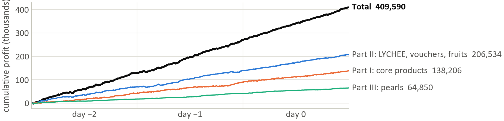

| 409,590 | 107,674 | 26 / 26 | 30 / 30 | 6.9K |
|:-:|:-:|:-:|:-:|:-:|
| profit over the 3 training days (site-verified) | profit on the unseen scoring day | products traded | 1,000-tick blocks that made money | largest drop in any day |

📄 **[Abstract (4 pages)](submissions/Team25_Abstract.pdf)** · 🎤 **[Finals slides](submissions/Team25_Slides.pdf)** ([.pptx with speaker notes](submissions/Team25_Slides.pptx)) · 🤖 **[The exact bot we submitted](submissions/Team25_Trader.py)**

---

## The competition

QuantiFi works like IMC Prosperity. Every tick, the exchange calls `Trader().run(state)` with every order book, our positions and the latest market trades. The bot answers with buy and sell orders. Each product has a position limit, from 20 for each pearl up to 200 for LYCHEE. A day is 10,000 ticks.

- **Data:** three days of order books and trades (days −2, −1 and 0).
- **Scoring:** the bot runs on a hidden **Day 1**. Judges also score breadth (trade every product), depth, and a written abstract of at most 5 pages.
- **Finals:** the top 8 teams gave a 7-minute talk with 3 minutes of Q&A.
- **26 products in three families:**
    - 6 core goods (AMETHYST, TOFFEE_CAKE, PAPER_LANTERNS, TELLURIUM, JELLY, PEANUT_BUTTER)
    - LYCHEE, its 10 call-option vouchers (strikes 6,800 to 8,100), 3 fruits and a fruit basket
    - 5 pearls

## Our approach: find a pattern first, then size the bet to it

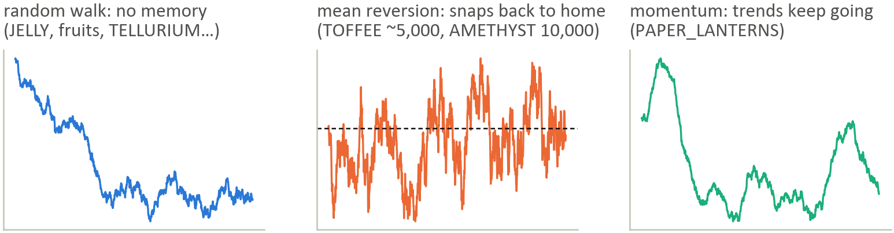

For each product we first asked one question: is there a pattern we can measure? How sure we were decided how big the bet was.

| Evidence | What the bot does | Products |
|---|---|---|
| **Strong pattern** | trade at full size | TOFFEE_CAKE · PAPER_LANTERNS · 10 vouchers · PINK · BLUE · GOLDEN · AMETHYST |
| **Probable pattern** | a deliberately sized bet | LYCHEE seems to be pulled back to ~7,436, so we bet half of what the backtest wanted |
| **No pattern** | small position caps, just earn the spread | TELLURIUM · JELLY · PEANUT_BUTTER · fruits · basket · WHITE · BLACK |

## Where the profit came from

<p align="center">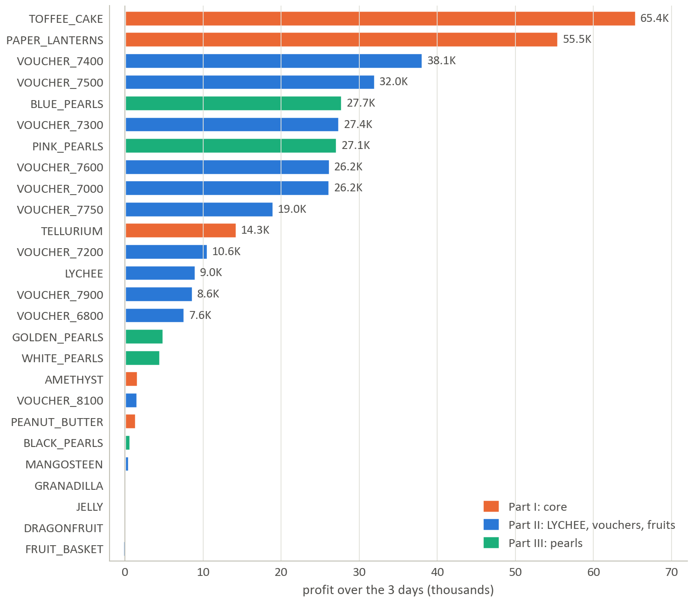</p>

<details>
<summary><b>Full table: profit by product and day</b></summary>

| Product | Day −2 | Day −1 | Day 0 | Total |
|---|--:|--:|--:|--:|
| **Part I: core** | **42,397** | **47,717** | **48,093** | **138,206** |
| TOFFEE_CAKE | 22,277 | 21,382 | 21,736 | 65,395 |
| PAPER_LANTERNS | 19,153 | 18,159 | 18,154 | 55,466 |
| TELLURIUM | 1,274 | 5,680 | 7,313 | 14,266 |
| AMETHYST | 527 | 608 | 478 | 1,612 |
| PEANUT_BUTTER | −346 | 1,710 | −3 | 1,362 |
| JELLY | −488 | 178 | 415 | 104 |
| **Part II: LYCHEE, vouchers, fruits** | **70,519** | **68,680** | **67,334** | **206,534** |
| VOUCHER_7400 | 12,780 | 15,391 | 9,910 | 38,082 |
| VOUCHER_7500 | 11,096 | 13,399 | 7,486 | 31,981 |
| VOUCHER_7300 | 12,353 | 7,605 | 7,435 | 27,393 |
| VOUCHER_7600 | 10,524 | 8,916 | 6,738 | 26,178 |
| VOUCHER_7000 | 5,895 | 3,361 | 16,902 | 26,158 |
| VOUCHER_7750 | 5,716 | 8,737 | 4,511 | 18,964 |
| VOUCHER_7200 | −1,277 | 4,024 | 7,811 | 10,558 |
| LYCHEE | 4,021 | 2,681 | 2,316 | 9,018 |
| VOUCHER_7900 | 5,213 | 1,460 | 1,951 | 8,624 |
| VOUCHER_6800 | 3,371 | 1,852 | 2,366 | 7,589 |
| VOUCHER_8100 | 780 | 450 | 306 | 1,536 |
| MANGOSTEEN | 122 | −62 | 426 | 485 |
| GRANADILLA | 30 | 78 | 8 | 115 |
| DRAGONFRUIT | 44 | 150 | −122 | 72 |
| FRUIT_BASKET | −148 | 638 | −707 | −218 |
| **Part III: pearls** | **17,511** | **24,221** | **23,118** | **64,850** |
| BLUE_PEARLS | 6,133 | 10,664 | 10,950 | 27,747 |
| PINK_PEARLS | 10,192 | 8,165 | 8,741 | 27,098 |
| GOLDEN_PEARLS | 125 | 1,998 | 2,762 | 4,886 |
| WHITE_PEARLS | 773 | 3,432 | 265 | 4,470 |
| BLACK_PEARLS | 288 | −38 | 400 | 650 |
| **Total** | **130,426** | **140,618** | **138,546** | **409,590** |

</details>

---

## The strategies

### Part I: core products (Ali), 138,206

| TOFFEE_CAKE: snaps back to ~5,000 | PAPER_LANTERNS: trends keep going |
|:-:|:-:|
| 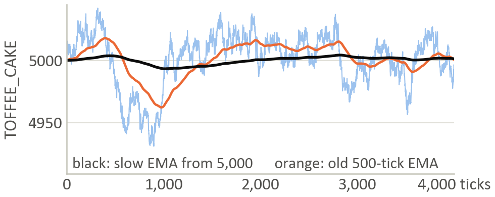 | 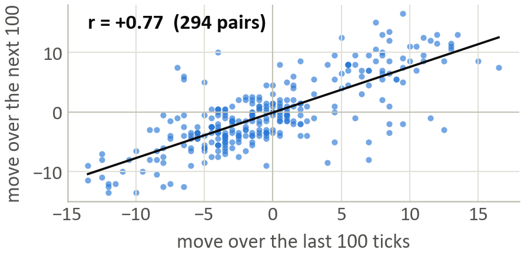 |
| Light blue is the price. Our fair value is a very slow average that **starts at 5,000** (black). Our first 500-tick average (orange) just chased the price. **65.4K** | Each dot is two back-to-back 100-tick moves. A rise is usually followed by another rise (r = +0.77). Fair value = average + 0.75 × the last 100-tick move. **55.5K** |

- **Trade-off:** hard-coding 5,000 for TOFFEE made a bit more (67.3K). But if the level shifted by 25 on the scoring day, it lost up to 7.3K a day, so we kept the version that adapts.
- **Robust:** every LANTERNS weight from 0.5 to 1.0 made 45 to 55K, so 0.75 isn't a lucky number.
- **AMETHYST** sits at exactly 10,000, so we buy at 9,999 and sell at 10,001.
- **TELLURIUM, JELLY and PEANUT_BUTTER** show no memory, so we quote around the spread with caps of 3 to 6.
- Part I went from **60.0K** in our first version to **138.2K**.

### Part II: LYCHEE and its options (Arham), 206,534

The 10 vouchers are call options on LYCHEE. We price them with Black–Scholes.

| One smile fits all ten strikes | Sell when 3.5 rich, buy when 3.5 cheap |
|:-:|:-:|
| 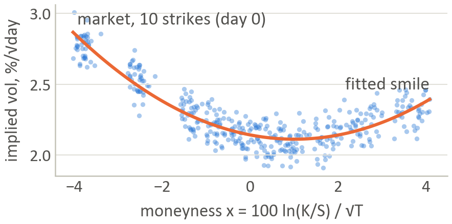 | 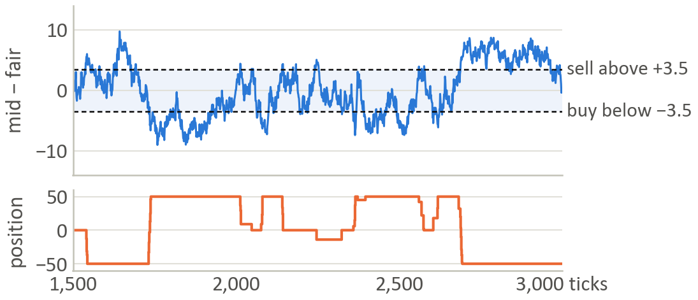 |
| We turn each voucher price into an implied volatility. All ten strikes fall on one parabola in moneyness, so one fitted smile prices every strike. | VOUCHER_7400: price minus our fair value (top) and our position (bottom). We close once the price is 1.5 past fair the other way. The position flips 10 to 40 times a day. |

- **197K from the vouchers**, our biggest source. One shared smile beats pricing each strike on its own: 62K versus 49K a day.
- **Trade-off:** holding vouchers is a hidden bet on LYCHEE. Hedging it would have cost 14 to 55K, so instead we shade our prices to lean against that exposure. This halves it (82 → 40) for about 1K.

**The LYCHEE lean: a pattern we weren't sure of, so we sized it**

<p align="center">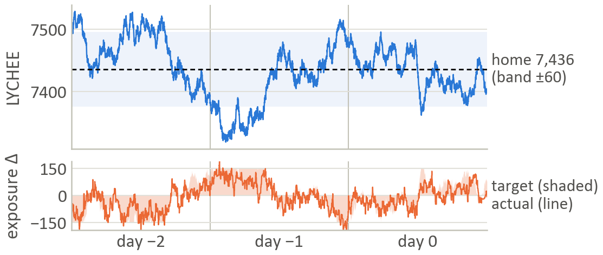</p>

LYCHEE looks random tick by tick, but over hours it kept returning to about 7,436.

- **The evidence is "probably", not "proven".** The ADF test gives −2.80, just short of the −2.86 bar. About 1 in 10 random walks look this leashed by luck.
- **How the bet works:** the further LYCHEE is from home, the more we lean against it, up to 150 LYCHEE-equivalents. We do it through the vouchers we already trade, so it adds no spread cost.
- **We halved it:** the backtest wanted 300.
- **What it's worth:** +10.5 to +14.1K on each held-out day. If LYCHEE runs the wrong way instead, we lose 13 to 15K that day.
- LYCHEE itself (9.0K) and the fruits and basket (+0.5K) are traded with caps of 10 and 1.

### Part III: pearls (Sepehr), 64,850

| PINK: fair value = 50,000 − the other four | BLUE: hold the creep, ride the drop |
|:-:|:-:|
| 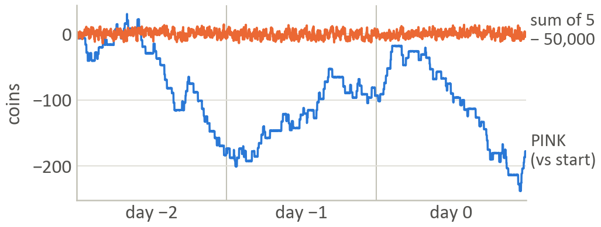 | 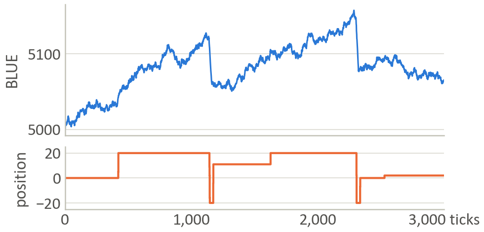 |
| The five pearls always add up to about 50,000 (orange, within a few coins). Meanwhile PINK alone wanders 200+ (blue). Only PINK moves to close the gap. **27.1K** | BLUE creeps up, then drops about 45 in under 50 ticks. We hold long through the creep and go short for the drop. **27.7K** |

- The same sum idea on the other pearls lost 10 to 30K each, so we only use it on PINK.
- **Trade-off:** a faster drop detector made 5K more in the backtest. On days with no sawtooth, though, it loses 18 to 23K, against about 2K for ours, so we kept the slower one.
- **GOLDEN** trades its step levels (4.9K). **WHITE and BLACK** use small caps (5.1K together).
- The pearls went from **7.0K** in our first version to **64.9K**.

---

## Challenges, and how we solved them

### 1. With 3 days of data, every tweak looks good

<p align="center">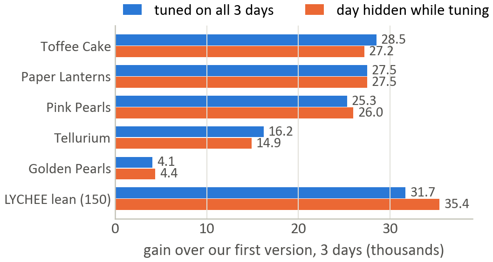</p>

Rule: **a change ships only if it beats the old version on every test.** The tests:

- each day and each half-day
- a 3-way rotation: tune on two days, score the hidden third, three times
- nearby settings
- stress days where the pattern is shifted, mirrored or removed

In the chart, blue is the gain when we tuned on all three days and orange is the gain on the day we hid. They match, so the gains are real and not fitted.

The rule also caught real overfitting. Re-tuned voucher settings looked better on the tuning days but lost 11.4K on the hidden days, so we kept the old settings.

### 2. UTEFA's site said 192K; our backtester said 415K

<p align="center">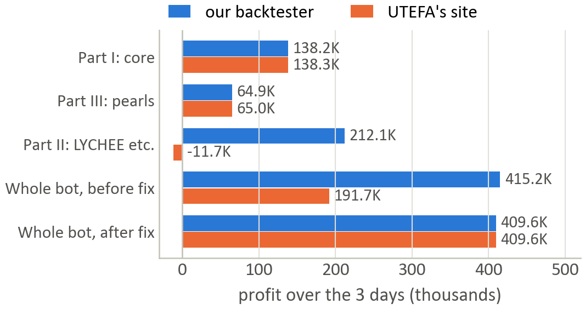</p>

This happened the night before the deadline.

1. We uploaded each part on its own. Core and pearls matched the site, but the LYCHEE part made 212K locally and **lost 11.7K** on the site.
2. The only input in that part we hadn't checked against the site was a trade-flow signal built from other traders' trades. The site serves those trades differently from our replay.
3. We turned the signal off. Both then said **409,590, to the coin**, and the signal had only been worth 5.6K.

**Lesson:** never depend on an input you can't verify, and cap every adjustment.

### 3. Profit that was really luck

Our first pearl bot made 7,034 and looked fine. We split its profit into two parts: what the quotes earned, and what came from holding a position while the price moved. **82% was holding luck.** For example, +3,295 on WHITE in one day came just from being short while it fell 460.

We split every product this way. We built only on real patterns (PINK's sum, BLUE's sawtooth, GOLDEN's steps) and cut the caps where there wasn't one. The pearls went from 7K to 65K, positive on all six half-days.

### 4. Four people, 26 products, one file

One crash, name clash or illegal order could wipe out everyone's trades.

- Each owner's code is a single class in `strategies/`.
- `build.py` pastes everything into one submission file and stops if two names clash.
- `trader.py` gives every strategy its own memory slot and its own error handling, and clips every order to the position limit.
- We fuzz-tested the final file with 3,000 broken ticks: **0 crashes and 0 bad orders**. It takes 0.31 ms per tick, and its saved state stays under 1,404 characters.

---

## Risk

| | Day −2 | Day −1 | Day 0 | **Day 1 (unseen)** |
|---|--:|--:|--:|--:|
| Profit | 130,426 | 140,618 | 138,546 | **107,674** |
| Largest drop (peak to low) | 6,255 | 6,870 | 3,399 | – |
| Sharpe-style ratio* | 5.8 | 6.4 | 6.6 | – |

\* mean ÷ standard deviation of the profit change per tick, scaled to one day (× √10,000). This is not an annualised fund Sharpe.

Day 1 came in below every training day but stayed clearly positive. It is the only true out-of-sample number we have. Before the scoring day, we had listed what each bet would cost if its pattern turned out not to exist:

| If this is wrong… | …it costs us, that day |
|---|---|
| LYCHEE has no leash | 13 to 15K |
| BLUE's sawtooth vanishes | about 2K |
| any other pearl pattern vanishes | at most 2 to 4K |

---

## What's in the repo

```
strategies/        one class per owner
  core.py            Part I: AMETHYST, TOFFEE_CAKE, PAPER_LANTERNS, TELLURIUM, JELLY, PEANUT_BUTTER (Ali)
  fruit_lychee.py    Part II: LYCHEE, 10 vouchers, 3 fruits, FRUIT_BASKET (Arham)
  pearls.py          Part III: WHITE, BLACK, GOLDEN, PINK, BLUE pearls (Sepehr)
  common.py          shared helpers
trader.py          the Trader UTEFA calls; runs the three strategies and clips orders to limits
backtest.py        our copy of UTEFA's backtester (matches the site to the coin)
build.py           glues everything into one submission file and backtests it
submissions/       what we handed in: Team25_Trader.py, Team25_Abstract.pdf, Team25_Slides.pdf/.pptx (finals)
analysis/          research notes, tests and write-ups (see below)
docs/img/          the charts in this README
data/ examples/ datamodel.py    UTEFA's data and starter files (unchanged)
```

**Write-ups**

- [`analysis/arham/deepdive/FINDINGS.md`](analysis/arham/deepdive/FINDINGS.md): which patterns are in the data, checked against past IMC Prosperity rounds
- [`analysis/arham/deepdive/lychee/LYCHEE_TEST.md`](analysis/arham/deepdive/lychee/LYCHEE_TEST.md): is LYCHEE leashed? Stats, risk and lean sizes
- [`analysis/arham/deepdive/rotation/ROTATION_TEST.md`](analysis/arham/deepdive/rotation/ROTATION_TEST.md): the 3-way rotation tests
- [`analysis/ali2/ALI2_TEST.md`](analysis/ali2/ALI2_TEST.md): how the core strategies were stress-tested
- [`analysis/sepehr2/SEPEHR2_TEST.md`](analysis/sepehr2/SEPEHR2_TEST.md): the pearl patterns and the luck-vs-edge split

**Branches:** `ali`, `arham` and `sepehr` hold each member's own work. `Ali2` and `Sepehr2` are the stress-tested versions of the core and pearl strategies. `main` is the final merge, which is the bot we submitted.

## Run it

Plain Python 3. The bot needs no numpy or pandas.

```bash
python backtest.py                                     # whole bot on days -2, -1, 0  ->  409,590
python backtest.py --only pearls                       # one part: core / fruit_lychee / pearls
python backtest.py --days -2 -1                        # tune on two days...
python backtest.py --days 0                            # ...then check on the third
python backtest.py --file submissions/Team25_Trader.py # the exact file we submitted
python backtest.py --log results/run.csv               # per-tick position + profit, for plots
python build.py                                        # rebuild the single-file bot from strategies/
```

## How we worked

1. **Edit only your own strategy file** (and your `analysis/` folder). Shared files changed only after telling everyone.
2. **Keep all code inside your class**, so `build.py` can merge the files without name clashes.
3. **Never tune on the day you check on.** We tuned on two days and scored the third.
4. **Build on how a product behaves** (it stays near a price, or it trends), not on where it happened to go.

---

<sub>Thanks to UTEFA for running QuantiFi 2026, to National Bank for sponsoring it, and to the judges from CPP Investments and National Bank. Some ideas were checked against public IMC Prosperity write-ups.</sub>
